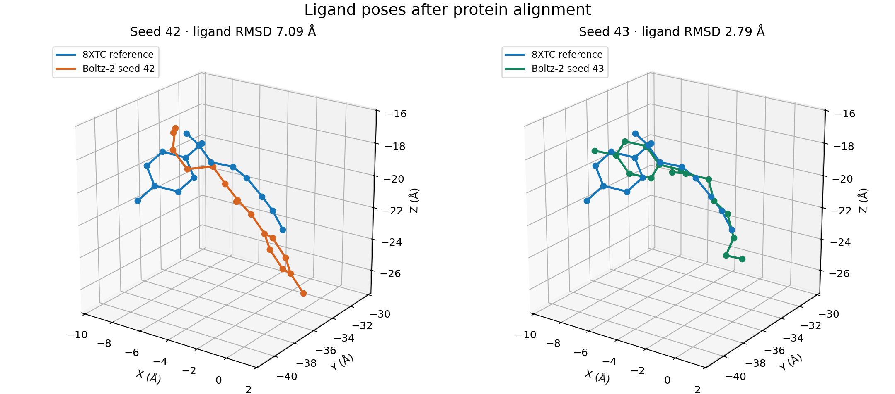

# Urethanase-Boltz2

A reproducible, ten-seed **Boltz-2 protein–ligand pose benchmark** for the
UMG-SP2 urethanase and the carbamate ligand A1D5H, using experimental structure
[PDB 8XTC](https://www.rcsb.org/structure/8XTC) as the evaluation reference.

**Finding:** in this case, Boltz-2 reproduces the protein backbone more
consistently than the experimental ligand pose. Sampling produces one substantially
closer pose, but most samples remain far from the experimental coordinates.

This is a small retrospective case study, not a new prediction model or evidence
of polyurethane degradation performance.

## Results

Ten samples (seeds 42–51) were evaluated with the same construct, ligand, MSA and
inference settings. Each seed produced one complex; every sample is reported.

| Metric | Result across ten seeds |
|---|---:|
| Protein Cα RMSD | 0.854–1.347 Å |
| Ligand heavy-atom pose RMSD, median | **7.046 Å** |
| Ligand pose RMSD, range | **2.791–7.213 Å** |
| Ligand pose RMSD, interquartile range | 6.731–7.108 Å |
| Lowest ligand RMSD | Seed 43: **2.791 Å** |
| Original sample | Seed 42: 7.090 Å |



Both panels use protein alignment and identical viewing limits. Blue is the
experimental ligand; orange is seed 42 and green is seed 43. Seed 43 is shown as
a retrospective diagnostic, not a prediction chosen without knowing the answer.


The highest model confidence belongs to seed 45, whose ligand RMSD is 7.114 Å.
Confidence therefore did not identify the closest sampled pose in this set.

See the [complete table and figures](results/multiseed/report.md),
[machine-readable CSV](results/multiseed/seeds.csv), and
[interpretation and limitations](docs/results.md).

## Reproduce the evaluation on a CPU

The repository includes the experimental reference, all ten predicted complexes,
the exact compressed MSA, and compact results. No GPU or model weights are needed
to evaluate the saved structures.

```bash
python -m venv .venv
source .venv/bin/activate
pip install -e ".[dev,report]"

# Verify the saved artifacts and run the offline tests.
sha256sum --check artifacts.sha256
pytest -m "not integration"

# Recompute the metrics for the original prediction.
urethanase-boltz2 evaluate \
  --reference data/reference/8XTC.cif \
  --prediction data/predictions/seed_42.cif \
  --ligand A1D5H --output results/recomputed_metrics.json

# Rebuild the ten-seed summary and comparison figure.
python scripts/summarize_seeds.py
python scripts/compare_poses.py
```

The saved hashes cover the published artifacts. Regenerating a plot may change
its image bytes across Matplotlib versions; metric values are the reproducibility
check. Use a fresh checkout to verify the original published checksums.

## Run a new prediction on a GPU

Use Python 3.10–3.12 in a separate environment. The tested inference dependencies
are in `cluster/requirements-inference.txt`; exact resolved versions from Hyperion
are in `cluster/environment.freeze.txt`.

```bash
pip install -r cluster/requirements-inference.txt
pip install -e ".[report]"
gzip -dc data/msa/umg_sp2_a1d5h_0.csv.gz > data/msa/umg_sp2_a1d5h_0.csv
python scripts/run_benchmark.py \
  --input inputs/umg_sp2_a1d5h_cached_msa.yaml \
  --out-dir results/new_seed_52 --seed 52
```

This reuses the exact MSA, without calling an MSA server. Boltz still needs its
model weights and CCD cache. The reference coordinates are used only by the
evaluator, never as a template, pocket constraint or contact constraint.

The [Colab notebook](notebooks/Urethanase_Boltz2_Colab.ipynb) first evaluates the
saved benchmark on CPU. An optional GPU section runs one new seed with the stored
MSA; it requires a compatible Python/GPU runtime.

## Protocol and scope

- Exact 454-position construct from 8XTC; one protein chain and one ligand.
- Boltz 2.2.1; three recycles, 200 diffusion steps, one sample per seed; optional CUDA kernels disabled.
- Protein alignment by mmCIF polymer sequence position; 440 experimental Cα atoms.
- Complete ligand heavy-atom name/element correspondence: 16 atoms.
- Protein Cα RMSD, protein-aligned ligand RMSD, and 4 Å contact precision/recall.
- Position 190 in this deposited construct is **ALA**. Its CB distance is a site
  marker, not a catalytic serine hydroxyl distance.

The experiment ran on an A100 80 GB in Hyperion. The nine additional seeds used
three ten-minute `test` jobs, with at most two user `test` jobs active at a time.
All three finished successfully. [Execution records](docs/multiseed.md) describe
the scheduling and preserve the original run provenance.

Possible training overlap with the PDB reference is unresolved. The experimental
assembly is a dimer, whereas the input models one chain. Reported RMSDs use CCD
atom names without symmetry correction. Ten samples from one complex do not
establish prospective accuracy, catalytic activity or a general success rate.
Fine-tuning, molecular dynamics and deployment are outside this project's scope.

## Repository guide

| Location | Contents |
|---|---|
| `src/urethanase_boltz2/` | Input generation, structure parsing, evaluation and CLI |
| `tests/` | Offline evaluator tests and an optional live-download test |
| `scripts/` | Inference, reporting and artifact verification |
| `inputs/` | Original and fixed-MSA Boltz YAML inputs |
| `data/` | Reference, ten predictions and compressed MSA ([inventory](data/README.md)) |
| `results/multiseed/` | Ten-seed table, statistics, figures and per-seed provenance |
| `results/report/` | Original seed-42 metrics and provenance |
| `cluster/` | Hyperion SLURM jobs and inference environment |
| `docs/` | Protocol, results and reproduction notes |

## References and license

- [Experimental structure: PDB 8XTC](https://doi.org/10.2210/pdb8XTC/pdb).
- Li et al. (2025), [*Structure-Guided Engineering of a Versatile Urethanase Improves Its Polyurethane Depolymerization Activity*](https://doi.org/10.1002/advs.202416019).
- [Boltz source code and model documentation](https://github.com/jwohlwend/boltz).

Project code is released under the [MIT license](LICENSE). The experimental
structure is distributed by the PDB; Boltz and its model assets retain their
upstream terms. Model weights are not included here.
