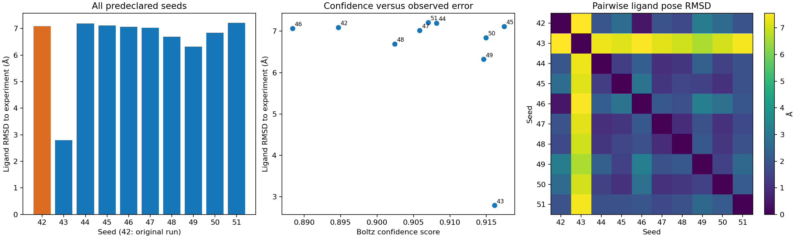

# Ten-seed benchmark

All ten predeclared seeds are included. The original seed 42 used the MSA server; the other nine used the exact saved MSA. All runs use one sample, three recycles and 200 diffusion steps.

| Seed | Protein RMSD (Å) | Ligand RMSD (Å) | Contact precision | Contact recall | Confidence |
|---|---:|---:|---:|---:|---:|
| 42 | 1.347 | 7.090 | 0.667 | 0.667 | 0.895 |
| 43 | 1.002 | 2.791 | 0.769 | 0.667 | 0.916 |
| 44 | 0.854 | 7.194 | 0.786 | 0.733 | 0.908 |
| 45 | 1.119 | 7.114 | 0.750 | 0.800 | 0.917 |
| 46 | 1.247 | 7.069 | 0.692 | 0.600 | 0.888 |
| 47 | 1.068 | 7.022 | 0.833 | 0.667 | 0.906 |
| 48 | 1.299 | 6.693 | 0.812 | 0.867 | 0.902 |
| 49 | 0.870 | 6.320 | 0.846 | 0.733 | 0.915 |
| 50 | 0.973 | 6.845 | 0.765 | 0.867 | 0.915 |
| 51 | 0.897 | 7.213 | 0.833 | 0.667 | 0.907 |

Ligand RMSD: median **7.046 Å**, range **2.791–7.213 Å**, interquartile range **6.731–7.108 Å**.

Pairwise distances use the protein-aligned coordinates and CCD atom names. No symmetry correction or post hoc pose-clustering threshold is applied. The lowest RMSD is a retrospective diagnostic, not a prospectively selected prediction. Ten samples do not establish a general success rate.
