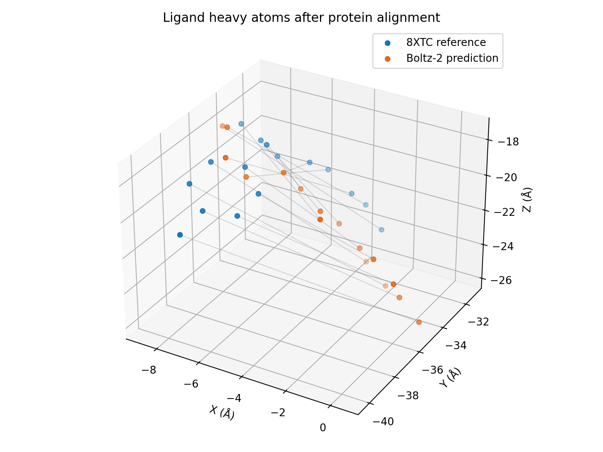

# Boltz-2 / 8XTC result

| Metric | Value |
|---|---:|
| Protein Cα RMSD (Å) | 1.3471 |
| Ligand pose RMSD (Å) | 7.0901 |
| Contact precision | 0.6667 |
| Contact recall | 0.6667 |
| Reference ALA190 CB distance (Å) | 3.0636 |
| Predicted site-marker distance (Å) | 3.5622 |

One sample, seed 42; no reference-based ranking. Distances use ALA190 CB, not a catalytic hydroxyl. Ligand RMSD uses CCD names without symmetry correction. This retrospective result does not establish prospective generalization or catalytic activity.

The protein backbone is similar to the reference, while the ligand pose differs substantially in this single run. Ten of fifteen experimental contact residues are recovered. See [full interpretation](../../docs/results.md).
